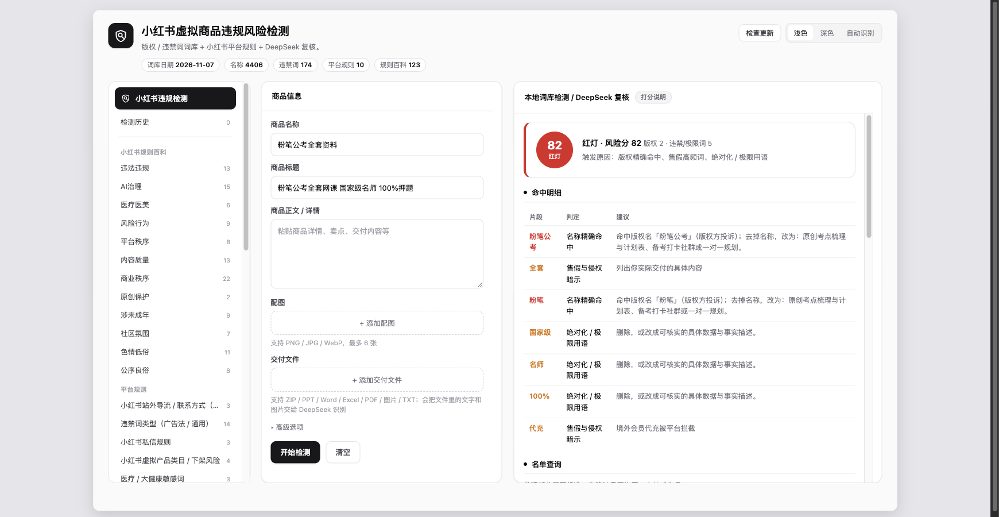
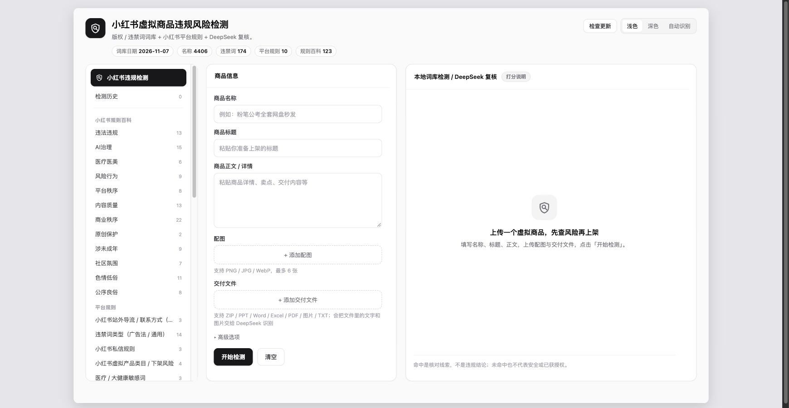
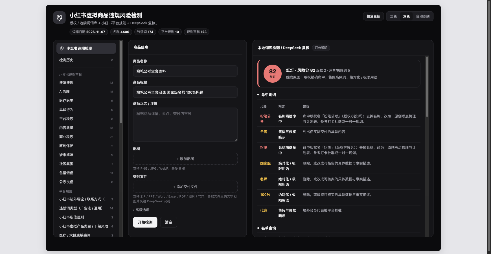
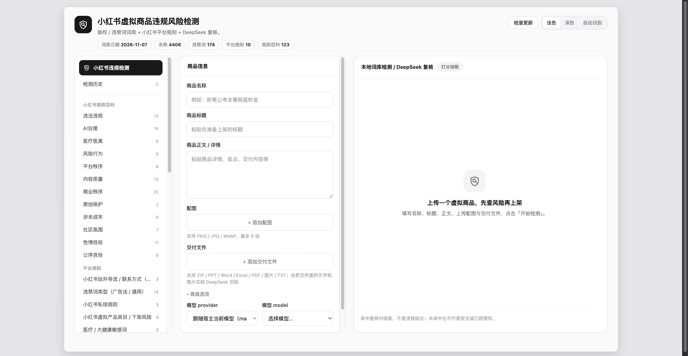
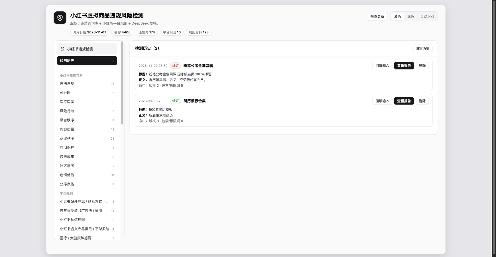
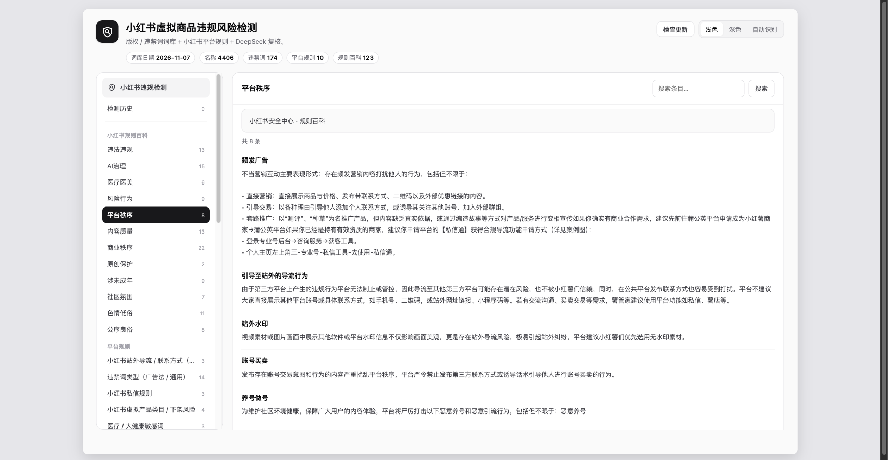

# Copyright-Risk-Detector · 小红书虚拟商品违规风险检测

一个 **DeepSeek Harness** 插件：在小红书虚拟商品上架 / 交付前，对**商品名称、标题、正文、封面配图、交付文件**做一次违规与版权风险检测——先用本地规则库离线筛查，再交给 DeepSeek 大模型识图 / 读文档复核，输出**风险分级、命中明细、改写建议与运营处置建议**。

[](https://www.npmjs.com/package/dsh-virtual-product-risk) [](https://npmmirror.com/package/dsh-virtual-product-risk)



---

## 功能

- **名单查询**：商品名称是否为历史风险名称、公司关联、部分匹配或疑似伪装写法（谐音 / 拼音 / 首字母 / 中英混写）。
- **标题体检**：扫描标题与正文里的版权名、违禁词与极限用语，逐条给出判定与改写建议；秒发、自动发货、网盘链接等正常交付词不参与扫描。
- **交付文件检测**：支持上传 ZIP / PPT / Word / Excel / PDF / 图片 / TXT，插件自动解包、提取文字、抽取其中图片，连同配图一起交给 DeepSeek 识图 / 读文档复核。
- **DeepSeek 复核**：把商品信息、配图、交付文件内容与本地命中结果交给大模型，按版权、违禁、极限词、平台规则、配图 / 文件等维度给出结构化结论与改写。
- **小红书规则百科**：内置小红书安全中心「规则百科」12 大类 123 条规则，可在「资料库」按分类浏览、搜索，并作为大模型复核的规则依据。
- **小红书平台规则**：站外导流 / 联系方式、私信规则、虚拟产品类目与承接方式、虚拟产品交付方式（正常）、AI 生成内容与虚假种草、账号 / 代充 / 代考代写 / 破解软件、医疗大健康、涉未成年人等（11 类）。
- **运营处置建议**：按「命中状态 × 产品领域 × 风险标签」本地合成红 / 黄 / 绿三档处置卡。
- **检测历史**：自动保存每次检测的输入与报告，左侧「检测历史」可回看，并支持「回填输入 / 查看报告 / 删除」。
- **自动更新**：右上角「检查更新」按钮，后台也会定时检测新版本；有新版本时按钮高亮为「可更新版本」，点击后优先走国内镜像更新，失败自动回退海外线路。
- **三种配色**：右上角「浅色 / 深色 / 自动识别」一键切换。

---

## 界面

### 检测工作台



填写商品信息、上传配图与交付文件，点击「开始检测」。

### 检测结果


左侧是资料库分类，右侧是结果：风险分与等级 → 命中明细 → DeepSeek 复核（含改写建议）→ 运营处置建议。右上角「打分说明」悬停可查看打分规则。

### 深色模式



### 高级选项（模型选择）



默认「跟随宿主当前模型」（官方登录态用户不用改）；有其它供应商时，可在下拉里选择 provider 与对应模型。

### 检测历史



每次检测自动留档（输入内容 + 完整报告），可一键「回填输入」或「查看报告」。

### 资料库



左侧按「小红书规则百科 / 平台规则 / 版权名单 / 违禁·极限词」分类，点开右侧查看规则条目，支持搜索。

---

## 环境要求

- 已安装 **DeepSeek Harness（dsh）**，能正常打开 Web UI；
- 支持 dsh `0.2.0-rc.2` 及以上（含 `0.2.1` / `0.2.2` 预发布版）；
- 安装走 npm / pnpm，能访问 npm 或国内镜像即可。

## 小白安装（把这句话发给 DeepSeek Harness）

还没装过 DeepSeek Harness？先看这份新手指南：[DeepSeek Harness 安装与使用指南（Windows / macOS）](https://my.feishu.cn/docx/N2rqdX4Wio5agyxJBpfcHtDmnlq)

装好 DSH 后，**不用记命令**，把下面对应的一句话直接发给它，它会帮你装好：

海外网络 / 能正常访问 GitHub：

```text
帮我安装这个插件到 DeepSeek Harness：https://github.com/onion716/Copyright-Risk-Detector/tree/main
```

国内网络（无 VPN，走 npmmirror 镜像）：

```text
帮我用国内镜像安装 DeepSeek Harness 插件 dsh-virtual-product-risk，registry 用 https://registry.npmmirror.com
```

## 安装

包名：**`dsh-virtual-product-risk`**（[npm](https://www.npmjs.com/package/dsh-virtual-product-risk) · [npmmirror 镜像](https://npmmirror.com/package/dsh-virtual-product-risk)）

> 下面的 `<profile>` 换成你的实际 profile 名；**桌面版一般是 `desktop`**。

### 海外 / 能直接访问 npm

```sh
dsh plugin --profile <profile> add dsh-virtual-product-risk
```

### 国内网络（无 VPN，走 npmmirror 镜像）

```sh
# 方式一：安装时直接指定镜像
dsh plugin --profile <profile> add dsh-virtual-product-risk --registry https://registry.npmmirror.com

# 方式二：先切全局镜像，再正常安装
npm config set registry https://registry.npmmirror.com
pnpm config set registry https://registry.npmmirror.com
dsh plugin --profile <profile> add dsh-virtual-product-risk
```

> npm 包的国内镜像用 **npmmirror（`registry.npmmirror.com`）**；清华 TUNA 只镜像 Node.js 安装包，不提供 npm 包查询/下载。镜像会自动同步 npm 新版本，若新版本暂未同步，可在 `https://npmmirror.com/sync/dsh-virtual-product-risk` 点「同步」。

### 从本地目录 / 源码安装（开发或离线）

```sh
git clone https://github.com/onion716/Copyright-Risk-Detector.git
dsh plugin --profile <profile> add /path/to/Copyright-Risk-Detector
```

也可以把仓库打成 zip 发给对方，解压后用上面的本地目录方式安装（本仓库已声明 `dsh.bundle`，无需额外构建）。

### 更新插件

**已经有了「检查更新」按钮的版本（v1.0.5 及以后）：**

工作台右上角点 **「检查更新」** → 出现 **「可更新版本」** 时点击即可。更新会优先走国内镜像（npmmirror），失败自动回退海外线路。

**更早安装、还没有更新按钮的版本：**

直接在 DeepSeek Harness 对话框里发一句话让它帮你更新。

国内网络（无 VPN）：

```text
帮我用国内镜像把 DeepSeek Harness 插件 dsh-virtual-product-risk 更新到最新版，registry 用 https://registry.npmmirror.com
```

海外网络：

```text
帮我把 DeepSeek Harness 插件 dsh-virtual-product-risk 更新到最新版
```

也可以手动执行：

```sh
dsh plugin --profile <profile> add dsh-virtual-product-risk@latest
```

国内同样可加 `--registry https://registry.npmmirror.com`。更新完成后，在 Web UI 左侧栏点击 **「小红书违规检测」** 进入工作台。

> 说明：插件目前通过 npm 包分发，**尚未收录进 dsh 官方插件市场**；收录后可直接在「插件 → 发现」搜索安装。在此之前请用上面的命令行方式。

## 使用说明

> 使用方式与网络环境无关（国内/海外一样），只是"怎么装"不同；下面按界面操作说明。

1. **打开工作台**：左侧栏点「小红书违规检测」，页面左上角显示「小红书虚拟商品违规风险检测」。
2. **填写商品信息**：商品名称、标题、正文 / 详情。
3. **上传素材**（可选）：
   - 「配图」：封面 / 详情图，最多 6 张；
   - 「交付文件」：要发给买家的 ZIP、PPT、Word、Excel、PDF、图片或 TXT，最多 8 个，插件会解压提取文字与图片。
4. **开始检测**：点击「开始检测」。本地词库与平台规则先跑一遍，再交给 DeepSeek 复核（默认跟随宿主当前模型；如用其他供应商，可在「高级选项」里从下拉中选择 provider 与模型）。
5. **看结果**：
   - 顶部大圆是**风险分**，颜色红 / 黄 / 绿；
   - 「命中明细」逐条列出命中的片段、判定与建议；
   - 「DeepSeek 复核」给出结论、发现与**改写建议**；
   - 「运营处置建议」给出红灯该怎么做、要拿什么授权、换什么方向。
6. **资料库**：左侧切换分类浏览规则；顶部搜索框可按关键词检索。
7. **检测历史**：左侧「检测历史」查看过往检测，可「回填输入」或「查看报告」；支持删除单条 / 清空。
8. **更新**：右上角「检查更新」手动检测（后台也会自动轮询）；出现「可更新版本」点击即可更新，优先国内镜像、失败走海外。
9. **配色**：右上角「浅色 / 深色 / 自动识别」随时切换。

### 风险打分怎么来的

- **本地等级**：版权精确命中 / 售假·假冒·破解类词 → 红；版权候选 / 侵权暗示 / 极限用语 → 黄；无命中 → 绿（按最严重一条定级）。秒发、自动发货、网盘链接、电子版、PDF 版等正常交付 / 商品形态词不参与判定。
- **处置卡分数**：基础分 + 风险标签权重（有作品登记号再加分），≥65 红、35–64 黄、<35 绿。
- **DeepSeek 复核**：模型给出 0–100 分与红 / 黄 / 绿。
- **综合等级**取本地与模型中更严重的一档；左上大分数优先显示模型分。
- 分数是规则 / 模型的风险判断分，**不是概率，也不等于法律结论**。

### 虚拟商品的「售假」判定口径

小红书支持**个人售卖**，也支持店铺 **「电子资源」类目 + 官方自动发货**；知识库、模板、PPT、课件、图片、资料等虚拟商品，通过网盘链接、飞书文档链接、邮箱或官方发货链接交付，都是正常履约方式，**不构成售假**。

本插件只在以下情况把内容按「售假 / 假冒」处理：冒充品牌方或官方正品、售卖盗版复制件、伪造授权、以假充真。正常交付词（秒发、自动发货、网盘链接、电子版、PDF 版等）不参与风险判定。

---

## 数据与许可

数据来源于网络公开信息，及小红书官方规则百科。

---

## 目录结构

```
package.json          # 含 dsh.bundle / dsh.client 声明
cordis.patch.yml      # 加载 Host 半的 loader 行
index.js              # Host 半：规则引擎 + DeepSeek 复核 + /virtual-product-risk/api/* 路由
client.js             # Client 半：shadcn 风格工作台（纯 JS，无需构建）
locale/{zh,en}.json   # 插件标题与描述
icon.svg              # 插件图标
assets/
  risk-library.json   # 版权 / 风险名称库
  banned-words.json   # 违禁 / 极限 / 正常交付词（正常交付不参与扫描）
  handling.json       # 处置建议规则
  platform-rules.json # 小红书平台规则
  xhs-rules.json      # 小红书规则百科（12 类 123 条）
  pinyin.json         # 拼音表（伪装名识别）
docs/
  images/             # 界面截图
  规则审查-售假判定-2026-11-08.md  # 本次「售假」判定规则审查记录
test/
  rule-classification.test.mjs      # 词库分类与检测回归测试
```
